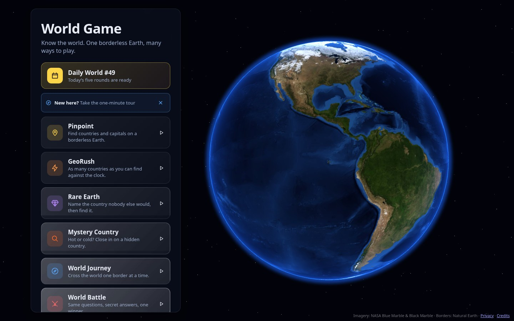

# World Game

A geography game on an interactive 3D globe. Learn countries and capitals in short lessons, test yourself in timed games, solve the daily puzzles, or challenge friends in a private room.

[Play World Game](https://world-game-0qhx.onrender.com)



## How it works

React runs the games, and Three.js draws the globe. Modes include finding countries and capitals, guessing a hidden country by distance, and crossing the world one border at a time. The browser keeps progress and personal bests. Online play uses a Node server with WebSocket rooms.

## Run locally

Use Node.js 22.12 or later and npm.

```sh
npm ci
npm run dev
```

Open the URL printed by Vite, starting at port 5174. For private multiplayer rooms, also run `npm run server` in another terminal. The server starts at port 8788. If it moves to another port, set `WG_SERVER_PORT` to that port when starting Vite.

[Game design](docs/design.md) · [Geography data and credits](docs/data.md) · [Deployment](docs/deployment.md)
