# Launch readiness report

A full check of World Game before its first deployment, on **2026-10-26**: what was run, what it
found, what was fixed, and what is still unverified. The owner's step-by-step guide is
[DEPLOY.md](../DEPLOY.md).

## Verdict

**Ready to deploy**, once the owner does the steps in DEPLOY.md that need accounts. Every check
that can run without a Fly.io, Resend, R2 or OAuth account was run and passes. Eleven problems were found
and fixed (below); eight of them would have hurt a real launch.

## What was checked

| Check                                                     | Result                                                                                                                                                               |
| --------------------------------------------------------- | -------------------------------------------------------------------------------------------------------------------------------------------------------------------- |
| `npm ci`, `npm run lint`, `npm run format:check`          | Pass                                                                                                                                                                 |
| Type check (`tsc -b`, all five projects)                  | Pass                                                                                                                                                                 |
| Unit tests (`npm test`)                                   | 50 files, 441 tests pass                                                                                                                                             |
| `npm audit --omit=dev`                                    | 0 vulnerabilities                                                                                                                                                    |
| Production build (`npm run build`)                        | Pass; 38 assets, 3.24 MB, 0.77 MB brotli                                                                                                                             |
| Browser tests, production build, Chromium desktop + phone | 83 pass, 0 fail                                                                                                                                                      |
| Browser tests, WebKit (iPhone 14)                         | 32 pass, 0 fail (run in Playwright's Docker image; WebKit's libraries are missing on this machine)                                                                   |
| Screenshot tour (69 scenarios, 3 screen sizes)            | All pass; no console errors on any real screen (below)                                                                                                               |
| Server checks against `npm start`                         | All pass (below)                                                                                                                                                     |
| Docker image (`docker compose up --build`)                | Builds in under 3 minutes (633 MB); healthy; runs as the `node` user; privacy contact built in; no test hooks in the shipped build; 26-screen screenshot pass clean  |
| Litestream backup and restore drill (MinIO)               | **Passed.** Deleted the data volume; on restart Litestream 0.5.17 restored every player, the nickname and the started daily, and the old session cookie still worked |
| GitHub CI                                                 | Its only run (2026-10-23) failed; the causes are fixed, not yet re-run                                                                                               |

### Server checks (production mode)

- `/health` and `/health/ready` answer; `/health/ready` returns `{"status":"ready"}`.
- Every page carries a content security policy (scripts only from the site, sockets only to the
  site's address, no framing), `nosniff`, a referrer policy, a permissions policy and
  `Cross-Origin-Opener-Policy`.
- Hashed assets are served brotli-compressed (a 66 KB script goes out as 20 KB) with
  `max-age=31536000, immutable`; data files cache for an hour; the page itself is `no-cache`.
- A write from another site is refused (403). A missing asset or API route is a real 404.
- `/api/dev/mailbox` is 404 in production. `/admin/counters` is 404 without the token or with a
  wrong one, and returns the counters with it.
- The sharing tags (`og:url`, `og:image`) use `PUBLIC_ORIGIN`.

## Problems found and fixed

| #   | Problem                                                                                                                                                                                                                                   | Impact at launch                                                                                      | Fix                                                                                                                                                                                                    |
| --- | ----------------------------------------------------------------------------------------------------------------------------------------------------------------------------------------------------------------------------------------- | ----------------------------------------------------------------------------------------------------- | ------------------------------------------------------------------------------------------------------------------------------------------------------------------------------------------------------ |
| 1   | CI's browser tests failed (4 of 117). Three were slowness on CI's software WebGL (ten accessibility audits in one 60 s test); one was a race where the WebKit daily test typed before the rules card opened.                              | Every push would show red; real regressions would hide among them                                     | Split the audits per screen, marked the two-device sign-in tests slow, waited for the game before the rules card. Also fixed a race in the clock-pause test.                                           |
| 2   | Behind Fly's proxy the server believed the first `X-Forwarded-For` entry, which the player controls.                                                                                                                                      | Anyone could dodge every per-address limit (new sessions, sign-in emails, rooms, connections)         | New `CLIENT_IP_HEADER` setting; `fly.toml` sets it to `fly-client-ip`. Tested with spoofed headers.                                                                                                    |
| 3   | `docker-compose.yml` did not pass `TRUST_PROXY` (or the limits, `ALLOWED_ORIGINS`, `LOG_REQUESTS`), and published the port on every interface.                                                                                            | Behind Caddy, every player would share one address: after 120 new players an hour, nobody could start | Passed through; bound to `127.0.0.1`.                                                                                                                                                                  |
| 4   | An empty `MAIL_FROM` (which compose sends when it is unset) became an empty sender.                                                                                                                                                       | Sign-in emails rejected by Resend                                                                     | Falls back to the default sender.                                                                                                                                                                      |
| 5   | `VITE_PRIVACY_CONTACT` could not reach a Docker or Fly build.                                                                                                                                                                             | The privacy page could never show a contact address                                                   | Build argument in the `Dockerfile`, `docker-compose.yml` and `fly.toml`.                                                                                                                               |
| 6   | Players saw developer text: "Online play needs the battle server running (`npm run server`)" on the Online screen and "Is it running? (npm run server)" when the connection dropped. The code placeholder showed 4 letters; codes have 5. | Looks unfinished                                                                                      | Development-only now; production says "Can't reach the game server." Placeholder `ABCDE`.                                                                                                              |
| 7   | Phones: the World Battle skill picker cut off "Cartographer" (its scrollbar is hidden, so it looked missing), and on 320 px phones two more pickers overflowed.                                                                           | Players could not see or pick the hardest bots                                                        | The skill pickers wrap as chips; segments are tighter at 360 px and below. Measured: nothing overflows at 320, 360, 390 or 412 px.                                                                     |
| 8   | Phone landscape: the "Find …" prompt covered your own row of the battle scoreboard; the result card squeezed "You found Belgium" into a narrow column; the battle reveal pushed **Ready** out of its panel.                               | Hard to read your own score; a clipped main button                                                    | Scoreboard moves to the bottom left in landscape; the verdict gets its own line; the reveal's timer bar can shrink.                                                                                    |
| 9   | The backup drill's MinIO image no longer exists (MinIO stopped publishing images), so `docker compose --profile backup` could not start. On WebKit, the accessibility audit could read a sheet mid-fade as low contrast.                  | The documented drill could not be run; CI would flicker red                                           | Replaced MinIO with Versity Gateway (pinned `v1.8.0`); audits run with reduced motion and print the measured contrast. A challenge-link test race was also fixed.                                      |
| 10  | Litestream used the floating `0.5` tag; CI used actions on the deprecated Node 20 runtime.                                                                                                                                                | Unreviewed upgrades; CI warnings                                                                      | Pinned `litestream/litestream:0.5.17`; actions moved to their Node 24 majors.                                                                                                                          |
| 11  | No Fly.io configuration.                                                                                                                                                                                                                  | —                                                                                                     | `fly.toml`: one always-on machine (rooms live in memory), a `/data` volume, `/health/ready` checks, and a connection limit of 1,000 instead of Fly's default 25, which would have turned players away. |

## Screenshots

From the final screenshot tour against the production server (`npm start`), after the fixes. The
tour drove every mode through play and results at desktop (1440×900), phone (Pixel 7) and phone
landscape sizes, plus a two-player room and the Quick Duel queue: 69 scenarios, none failed. The only
console errors were from the two deliberate failures it visits, the crash page and a missing file.

### Desktop

| Home                                           | Daily hub                                      | Pinpoint result                                |
| ---------------------------------------------- | ---------------------------------------------- | ---------------------------------------------- |
|                 |            |    |
| **Pinpoint summary**                           | **GeoRush**                                    | **Rare Earth reveal**                          |
| 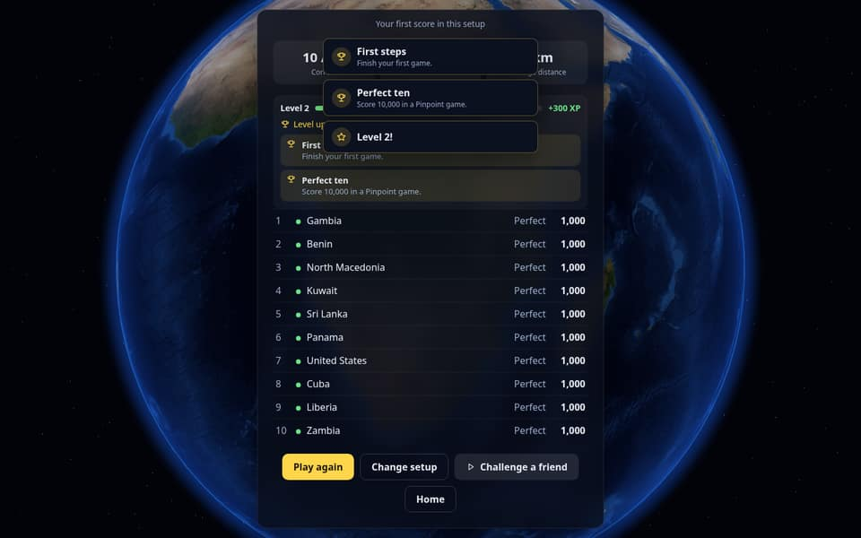  |      | 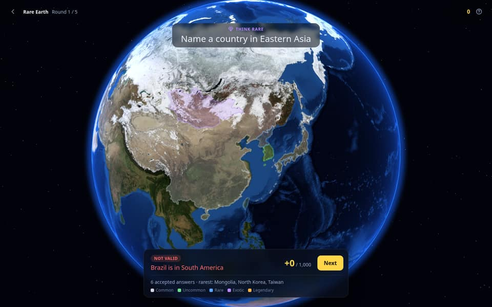 |
| **Mystery Country**                            | **Mystery results**                            | **World Journey**                              |
| 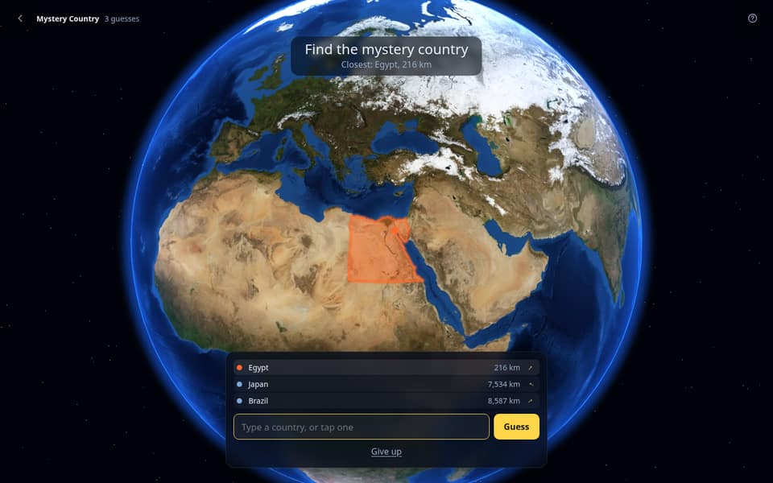   | 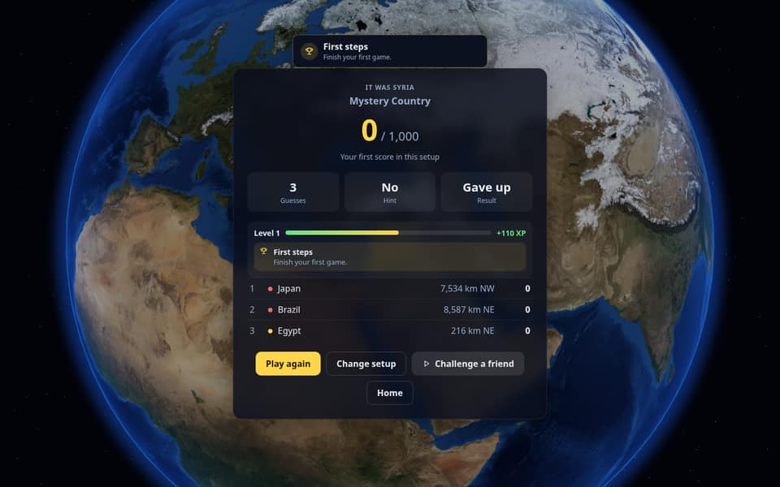   | 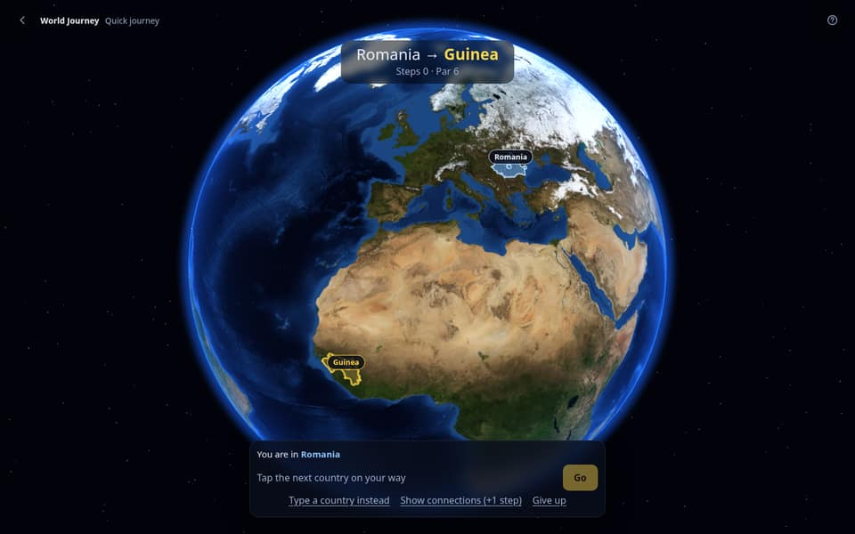             |
| **World Battle reveal**                        | **Daily Five result**                          | **Private room, two players**                  |
| 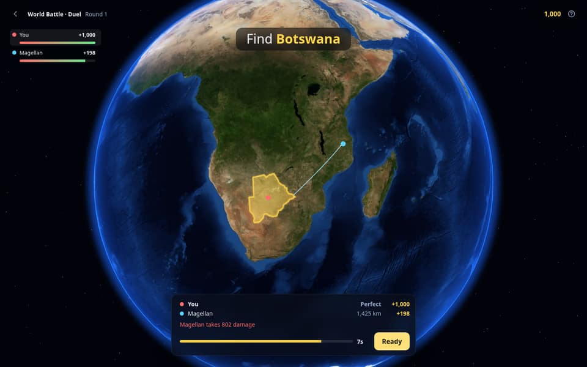     | 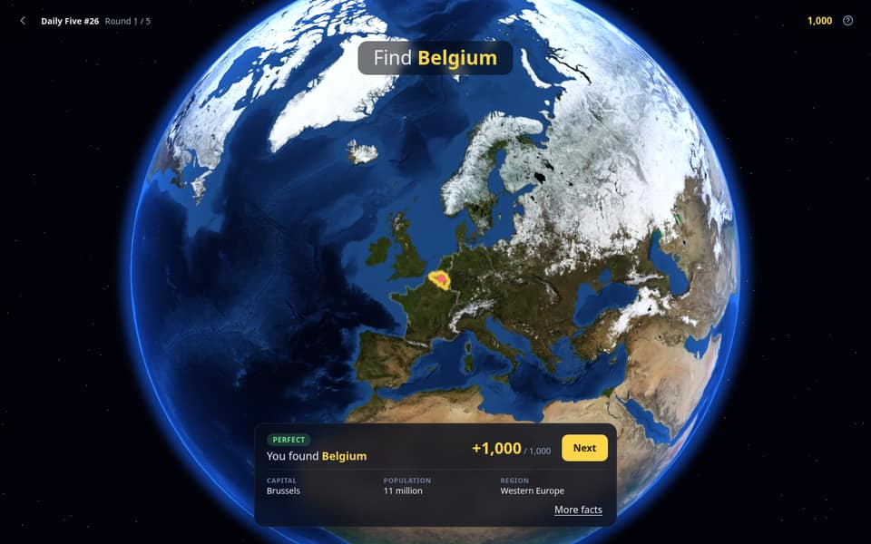 | 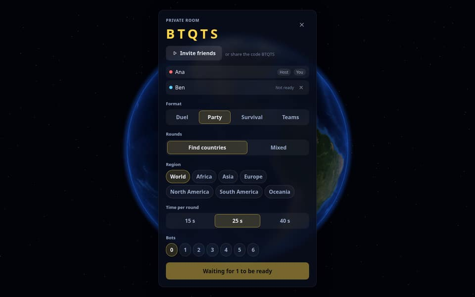          |
| **Quick Duel queue**                           | **Leaderboards**                               | **Settings**                                   |
| 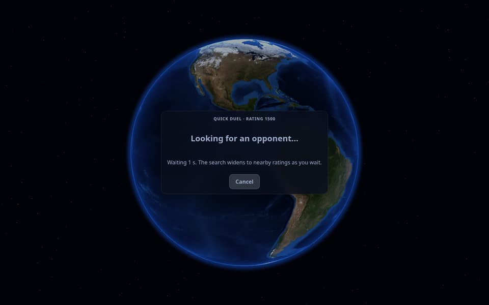 | 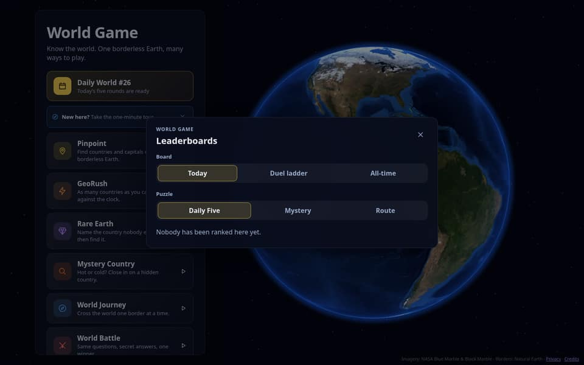        | 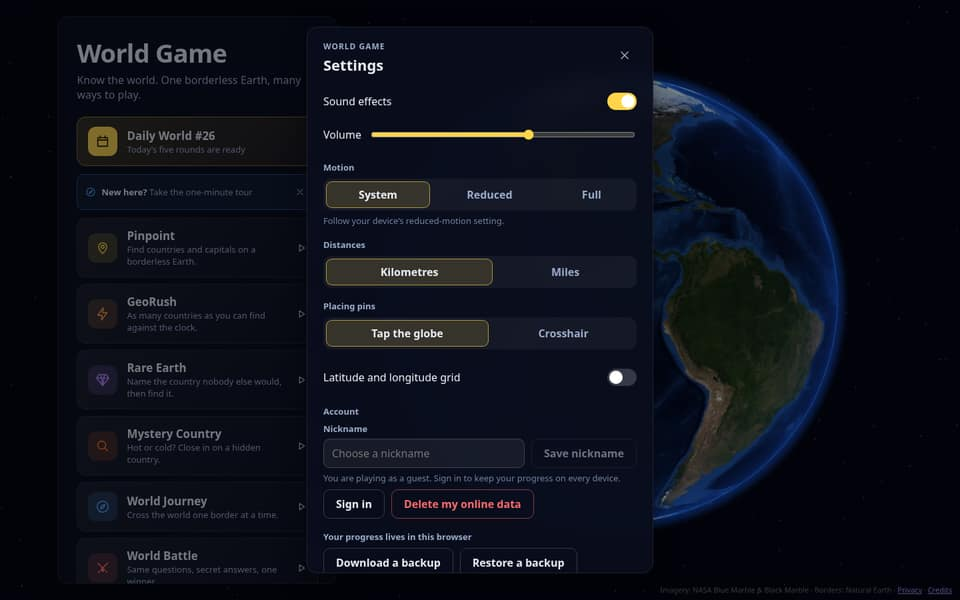            |
| **Privacy**                                    | **Error page**                                 |                                                |
| 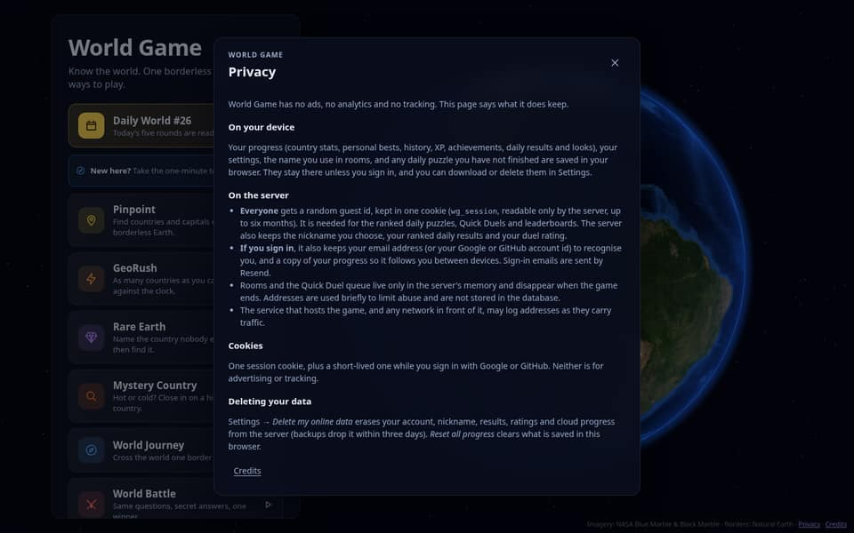             |           |                                                |

### Phone

| Home                                | Pinpoint result                            | Battle setup (fix 7)                    | Mystery Country                            |
| ----------------------------------- | ------------------------------------------ | --------------------------------------- | ------------------------------------------ |
| 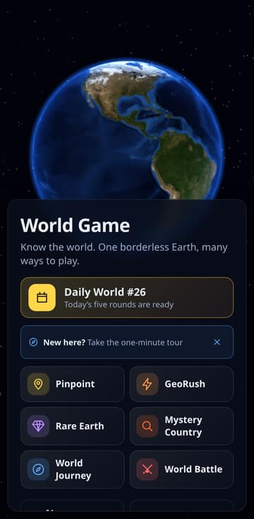       |  | 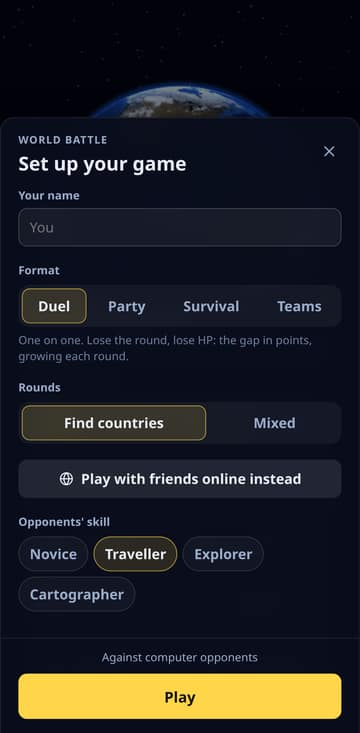 |  |
| **Room lobby**                      | **Daily hub**                              | **Sign in**                             | **Tour**                                   |
| 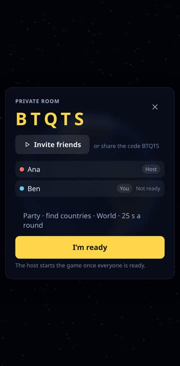 | 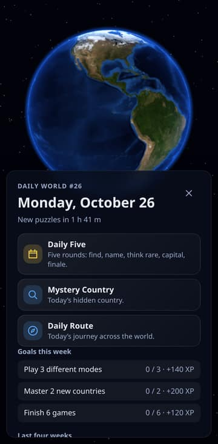         | 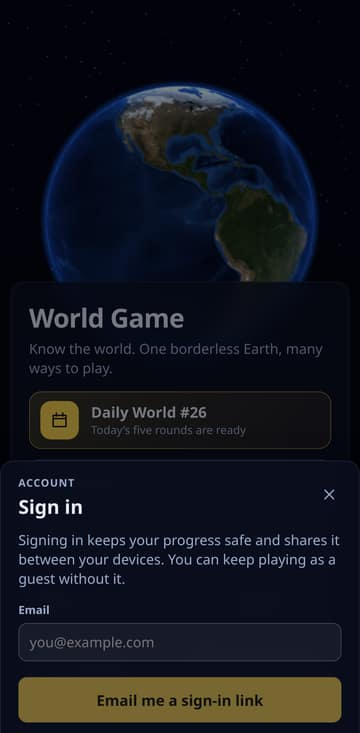         |         |

### Phone landscape (fix 8)

| Battle question                                  | Battle reveal                                |
| ------------------------------------------------ | -------------------------------------------- |
| 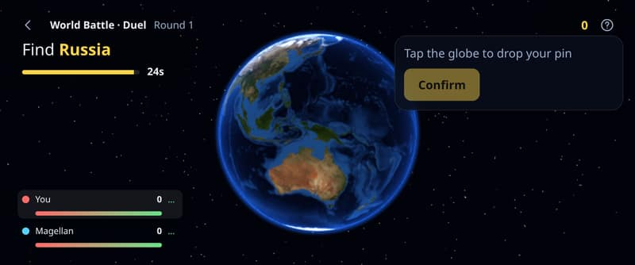   |  |
| **Daily Five result**                            | **World Journey**                            |
|  |          |

## Still unverified (and why)

- **Fly.io itself.** It needs an account. `fly.toml` parses as TOML and follows Fly's documented
  keys, but it was not checked by `fly config validate`: downloading `flyctl` was not allowed in
  this session. The first `fly deploy` will validate it.
- **Real Resend email, real R2, real Google and GitHub sign-in.** They need the owner's accounts.
  The code paths are covered by unit tests against mocks, and the backup path by the MinIO drill.
- **GitHub CI.** The fixes are committed but not pushed, so CI has not re-run.
- **Behaviour under a real crowd.** The load test (300 simulated players, in
  [deployment](deployment.md)) ran on a fast desktop, not on a Fly shared CPU.
- **The privacy page** describes what the code does. It is not legal advice; have it reviewed.
- **Not fixed, by design:** achievement toasts briefly cover the top of the results card when
  several unlock at once (they fade after a few seconds).
- **Browser tests in development mode** (Vite dev server) were not re-run; CI tests the production
  build, which is what was run here.
